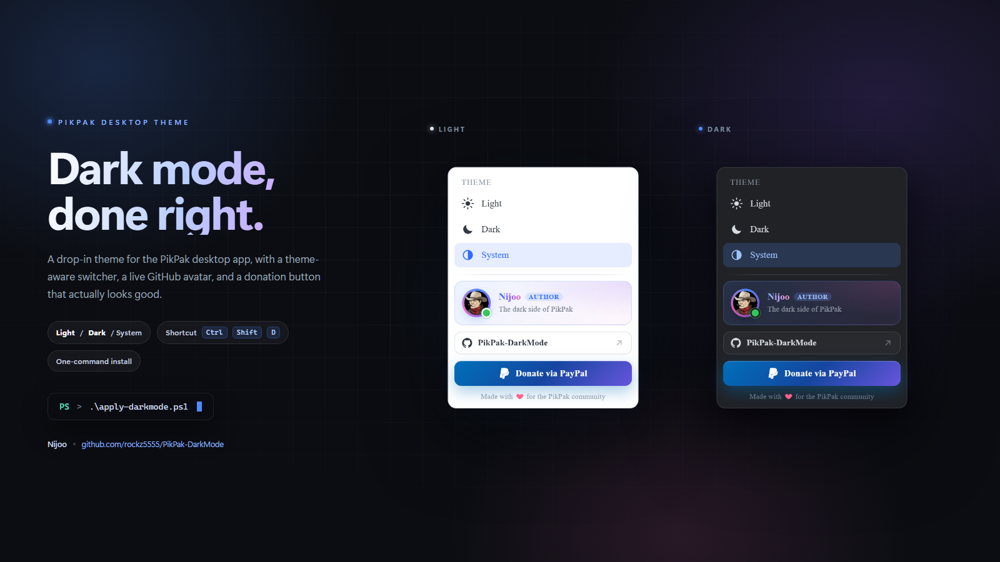
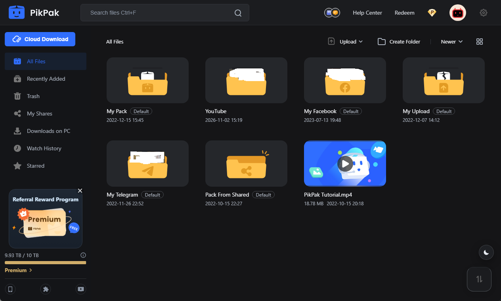
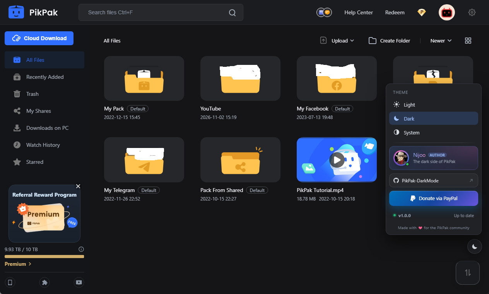

<div align="center">



# PikPak Dark Mode

A drop-in dark theme for the **PikPak desktop app** — theme-aware controls and a one-command installer that backs itself up.


[Quick start](#quick-start) · [Commands](#command-reference) · [How it works](#how-it-works) · [Troubleshooting](#troubleshooting) · [Support](#support)

</div>

---

## Why you'll like it

| Feature                  | What it does                                                                         |
| ------------------------ | ------------------------------------------------------------------------------------ |
| **Real theme switching** | Light, Dark, and System modes, remembered across launches.                           |
| **Theme-aware panel**    | The switcher, author card, and donation button all adapt to the active theme.        |
| **Themed landing**       | The magnet-link card and folder picker follow the same light/dark theme.             |
| **Themed dialogs**       | Cloud-download, completion, and external-player "Play Mode" popups match the theme.  |
| **In-app updates**       | A delta updater card: only changed files, with Apply, Apply and restart, or skip.    |
| **Knows its host**       | The panel names the exact PikPak build the patch was applied to, with the patch date. |
| **Safe by design**       | Timestamped backups before every change and an idempotent installer you can re-run.  |
| **One-command restore**  | `-Restore` removes the injection and the copied assets, leaving your backups intact. |
| **Zero dependencies**    | Plain PowerShell plus a few CSS/JS files. No build step, no runtime.                 |

## Screenshots

Captured from PikPak 2.15.5 on Windows 11. Click an image to open it full size.

| Dark mode | Light mode |
| :---: | :---: |
| [](docs/screenshots/main-dark.png) | [](docs/screenshots/main-light.png) |
| [](docs/screenshots/theme-panel-dark.png) | [](docs/screenshots/theme-panel-light.png) |

The round button at the bottom-right opens the theme panel; <kbd>Ctrl</kbd> + <kbd>Shift</kbd> + <kbd>D</kbd> toggles between light and dark.

## Quick start

1. Clone or download this repository.
2. Open **PowerShell** in the repository folder.
3. Run the installer:

   ```powershell
   .\apply-darkmode.ps1
   ```

4. Reopen PikPak — or let the script do it:

   ```powershell
   .\apply-darkmode.ps1 -Restart
   ```

That's it. Use the round button at the bottom-right of PikPak, or press <kbd>Ctrl</kbd> + <kbd>Shift</kbd> + <kbd>D</kbd>.

> Running into `running scripts is disabled on this system`? Use the bypass form:
>
> ```powershell
> powershell -ExecutionPolicy Bypass -File .\apply-darkmode.ps1
> ```

## Command reference

Run these from the folder that contains `apply-darkmode.ps1`.

| What you want                       | Command                                                         |
| ----------------------------------- | --------------------------------------------------------------- |
| Install or update the theme         | `.\apply-darkmode.ps1`                                          |
| Install and relaunch PikPak         | `.\apply-darkmode.ps1 -Restart`                                 |
| Check the current status            | `.\apply-darkmode.ps1 -Status`                                  |
| Target a custom install folder      | `.\apply-darkmode.ps1 -InstallDir "D:\Apps\PikPak"`             |
| Target a custom folder and relaunch | `.\apply-darkmode.ps1 -InstallDir "D:\Apps\PikPak" -Restart`    |
| Remove the theme                    | `.\apply-darkmode.ps1 -Restore`                                 |
| Remove and relaunch PikPak          | `.\apply-darkmode.ps1 -Restore -Restart`                        |
| Skip self-elevation                 | `.\apply-darkmode.ps1 -NoElevate`                               |
| Skip the update helper              | `.\apply-darkmode.ps1 -NoAgent`                                 |
| Bypass the execution policy         | `powershell -ExecutionPolicy Bypass -File .\apply-darkmode.ps1` |

### Parameters

| Parameter            | Type   | Description                                                                                                                                                 |
| -------------------- | ------ | ----------------------------------------------------------------------------------------------------------------------------------------------------------- |
| `-InstallDir <path>` | String | Folder that contains `PikPak.exe`. Auto-detected from the registry and common install paths when omitted. Works with `-Status`, `-Restore`, and `-Restart`. |
| `-Status`            | Switch | Prints the detected install folder, app version, UI file, whether the theme is applied, and the backup folder. Changes nothing.                             |
| `-Restart`           | Switch | Force-closes and relaunches PikPak after applying or restoring.                                                                                             |
| `-Restore`           | Switch | Removes the injected block and the copied theme assets. Backups are preserved.                                                                              |
| `-NoElevate`         | Switch | Internal flag used by the self-elevation relaunch. Skips the UAC relaunch; useful when the current shell is already elevated.                               |
| `-NoAgent`           | Switch | Skips the local update helper. Update checks still work, but the card cannot install anything.                                                               |
| `-UpdateSource <url>` | String | Points the installed updater at another manifest base URL (for example the playground). Run again without it to return to GitHub.                            |

### Status output

```text
PikPak Dark Mode status
  Install folder : C:\Program Files\PikPak
  App version    : 2.15.5
  UI file        : C:\Program Files\PikPak\resources\app\out\main-renderer\index.html
  Theme          : applied
  Backup folder  : C:\Users\you\PikPak-DarkMode\backups
```

### Notes

- Installing into `Program Files` triggers a **UAC prompt**. Cancelling it leaves PikPak untouched.
- Every run is **idempotent**: the old injection is replaced, never duplicated.
- `-Restart` force-closes PikPak, so finish any in-flight transfers first.
- Any flag combination works — for example `.\apply-darkmode.ps1 -Status -InstallDir "D:\Apps\PikPak"`.

## Theme controls

| Control                                           | Action                         |
| ------------------------------------------------- | ------------------------------ |
| Round button (bottom-right)                       | Opens the theme panel          |
| Light / Dark / System                             | Switches the active mode       |
| <kbd>Ctrl</kbd> + <kbd>Shift</kbd> + <kbd>D</kbd> | Toggles between light and dark |
| <kbd>Esc</kbd>                                    | Closes the panel               |
| Version row (bottom of the panel)                  | Checks for updates and shows their state |
| PikPak build badge (above the version row)         | Shows the exact PikPak build this patch was applied to and when |
| <kbd>Esc</kbd> or close button (landing popup)     | Closes the landing window      |

Your choice is stored in `localStorage` under `pikpak-theme` and restored on the next launch. The switcher hides itself on the player and file-manager routes so it never covers fullscreen content, and while a modal dialog is open. PikPak's separate window for external magnet links (`#/landing`) follows the saved mode but uses a compact, card-style layout that matches the main app: an inset artwork hero, a glass magnet pill, a gradient primary action, and a themed "Modify" folder picker that always fits the narrow window. The popup window itself is transparent, so the card floats on a small inset margin instead of painting a full-window black or white backdrop, and the artwork falls back to a soft light gradient in light mode and a deep one in dark mode. That popup never shows the floating switcher; use its own close button or <kbd>Esc</kbd> instead.

## How it works

1. Locates the PikPak install by checking the Windows registry and common folders.
2. Backs up `index.html` into `backups/`, with a matching version note.
3. Copies the theme assets next to the app's renderer: the stylesheet, the updater stylesheet, both scripts, and the installed-version manifest.
4. Injects a small, clearly marked block into the app's `index.html`:

   ```html
   <!-- PIKPAK-DARKMODE:START - managed by apply-darkmode.ps1, do not edit -->
   ...
   <!-- PIKPAK-DARKMODE:END -->
   ```

   The same block carries a one-line `window.__PPDM_PATCH__` record with the PikPak build and install date, so the panel can name exactly which app version it was applied to. If that record is missing (for example, after an older install), the panel falls back to PikPak's own `SENTRY_RELEASE` id, then to an optional `pikpak` field in the theme manifest.

5. Verifies the change. If verification fails, the backup is restored automatically.
6. Installs a small local update helper in `%LOCALAPPDATA%\PikPak-DarkMode` and registers it for the current user, so the in-app updater can install future releases without touching the protected install folder. Use `-NoAgent` to skip this.

Nothing else is touched. No system settings are changed, and no telemetry, analytics, or account data is collected. The only external requests are the GitHub avatar image in the panel and the release manifest check described below.

## Automatic updates

The theme checks for a new release shortly after every launch and shows a small card in the bottom-left corner when one exists:

| Choice | What it does |
| --- | --- |
| **Apply and restart** | Installs the release and relaunches PikPak, so the new theme is active immediately. |
| **Apply** | Installs in the background and offers a *Reload now* button; PikPak keeps running. |
| **Skip this version** | Silences that release. A newer release still prompts. |

Only files that actually changed are downloaded. The release and the installed theme each carry a SHA-256 for every asset, so a typical release pulls one or two small files instead of the whole theme — the card states the saving up front ("2 of 4 files · 38 KB instead of 96 KB"). Every download is hashed before it is staged, and the helper re-hashes it before it touches disk.

The card names the theme it belongs to ("PikPak Dark Mode", with the update state and version chips underneath) and carries a small green shield chip naming the PikPak build it was last applied to. It follows the active light or dark theme, never blocks the app, and hides itself during fullscreen playback, on the landing page, and while a PikPak dialog is open. <kbd>Esc</kbd> or the close button hides it until the next launch; *Skip this version* is the persistent choice. A pulsing dot on the floating switcher and a status row in the theme panel ("v1.1.0 · Up to date") keep the state visible without nagging.

The theme panel shows the host build above that row — for example `PikPak 2.15.5.5917`, `Last patched 5 Nov 2026`, and a green **Tested** badge — so it is obvious which PikPak version the patch belongs to. The same build appears as a compact shield chip on the update card.

The helper is a loopback-only process (`127.0.0.1:48179`) started by the installer. It is protected by a per-install token, only accepts `pikpak-darkmode*` `.css`/`.js` files inside the theme folder, keeps one timestamped backup per update, and replaces files through a temporary copy — a failed update leaves the previous theme intact. See [docs/updates.md](docs/updates.md) for the full protocol.

Publishing a release takes one command:

```powershell
.\tools\build-update.ps1 -Version 1.1.0 -Notes "Themed the transfer list" "Faster first paint"
```

Commit `theme/` and `update/` and running apps pick it up on their next check.

### Try it without publishing

`tools/update-playground.ps1` serves a fake release on loopback and prints the two console lines that point the updater at it:

```powershell
.\tools\update-playground.ps1          # serves http://127.0.0.1:8787/
```

It copies the theme into `.playground/`, advertises the next version, appends one visible demo rule so there is a real one-file delta, starts the update helper if it is not running, and copies the snippet to the clipboard. Nothing in the repo or in PikPak changes until you click **Apply**:

```js
localStorage.setItem('ppdm-update-source','http://127.0.0.1:8787/');
PikPakUpdater.check({force:true, interactive:true});
```

`PikPakUpdater.reset()` drops the override again, <kbd>Ctrl</kbd>+<kbd>C</kbd> stops the server, and `.playground/` is gitignored and disposable.

If you would rather skip the console step, point the installed build at the playground once and just restart PikPak:

```powershell
.\apply-darkmode.ps1 -UpdateSource http://127.0.0.1:8787/
```

That records the source in the injected loader, so the card appears on its own five seconds after launch. Re-run `.\apply-darkmode.ps1` without the switch to go back to GitHub.

## After a PikPak update

PikPak updates replace `index.html`, which removes the injection. The in-app updater keeps the theme assets current, but the loader block can only be written by the installer — re-run it after each PikPak update:

```powershell
.\apply-darkmode.ps1 -Restart
```

Check `-Status` any time to confirm whether the theme is currently applied.

## Uninstall

```powershell
.\apply-darkmode.ps1 -Restore -Restart
```

This removes the injection and the copied theme assets. Backups in `backups/` are kept; delete that folder manually if you want them gone too.

## Troubleshooting

| Problem                                 | Fix                                                                                                 |
| --------------------------------------- | --------------------------------------------------------------------------------------------------- |
| `Could not find a PikPak installation.` | Pass the folder that contains `PikPak.exe`: `.\apply-darkmode.ps1 -InstallDir "C:\Path\To\PikPak"`. |
| `expected UI file is missing`           | Confirm `resources\app\out\main-renderer\index.html` exists inside the folder you passed.           |
| Theme doesn't appear                    | Restart PikPak. If it still doesn't show, run `.\apply-darkmode.ps1 -Status`.                       |
| Theme disappeared after an app update   | PikPak replaced `index.html`. Re-run the installer.                                                 |
| Update card says the helper is offline  | Run `.\apply-darkmode.ps1` (it registers and restarts the helper) or sign out and back in.          |
| Update fails with a checksum warning    | Nothing was changed. Retry once; if it repeats, re-run the installer.                               |
| Update prompt never appears             | It checks on every PikPak launch. A dismissed prompt returns on the next launch; **Skip this version** stays hidden until a newer release. You can also click the version row to check now. |
| Script won't run                        | Use `powershell -ExecutionPolicy Bypass -File .\apply-darkmode.ps1`.                                |
| Switcher invisible                      | It hides on player/file-manager and magnet-link (`#/landing`) routes and open dialogs by design, and can sit behind fullscreen video. |
| Magnet-link popup looks light           | The popup follows the saved mode. Switch the mode in the main window (or with Ctrl+Shift+D), then reopen the link. The popup has no floating switcher by design; use its close button or Esc. |
| Avatar is a gradient "N"                | GitHub couldn't be reached; the fallback is intentional and retries on the next launch.             |

## Theme API

The theme exposes a small API on `window.PikPakTheme`:

| Call                                            | Result                            |
| ----------------------------------------------- | --------------------------------- |
| `PikPakTheme.set('dark')`                       | Sets `light`, `dark`, or `system` |
| `PikPakTheme.get()`                             | Returns `{ mode, dark }`          |
| `PikPakTheme.toggle()`                          | Flips between light and dark      |
| `PikPakTheme.light()` / `.dark()` / `.system()` | Shorthand setters                 |
| `PikPakTheme.key`                               | The storage key (`pikpak-theme`)  |

The updater adds a second API:

| Call                                                   | Result                                        |
| ------------------------------------------------------ | --------------------------------------------- |
| `PikPakUpdater.check({ force: true, interactive: true })` | Checks now and shows the update card        |
| `PikPakUpdater.apply()` / `.applyAndRestart()`         | Installs the pending delta                     |
| `PikPakUpdater.skip()`                                 | Skips the offered version                      |
| `PikPakUpdater.installed()`                            | `{ version, bootstrap, released, files }`      |
| `PikPakUpdater.reset()`                                | Clears check state, skip marker, and overrides |

## Project layout

```text
PikPak-DarkMode/
├─ apply-darkmode.ps1        # installer, status, and restore
├─ agent/
│  └─ ppdm-update-agent.ps1  # loopback update helper (copied per user)
├─ theme/
│  ├─ pikpak-darkmode.css    # all visual overrides
│  ├─ pikpak-darkmode.js     # switcher, persistence, panel
│  ├─ pikpak-darkmode-updater.css
│  ├─ pikpak-darkmode-updater.js   # update engine + card
│  └─ pikpak-darkmode.version.js   # installed version manifest (generated)
├─ tools/
│  └─ build-update.ps1       # regenerates both manifests
├─ update/
│  └─ manifest.json          # published release manifest
├─ docs/
│  ├─ screenshots/           # real app captures (dark + light)
│  │  ├─ main-dark.png
│  │  ├─ main-light.png
│  │  ├─ theme-panel-dark.png
│  │  └─ theme-panel-light.png
│  ├─ preview.png            # project preview
│  └─ updates.md             # updater architecture
└─ backups/                  # generated: original index.html + version notes
```

## Support

<div align="center">

**Built by Nijoo**

[](https://github.com/rockz5555)
[](https://github.com/rockz5555/PikPak-DarkMode)
[](https://www.paypal.me/nizwer)

If this theme made your PikPak look better, a star on the repo or a small tip goes a long way.

</div>

## License

This project is licensed under the MIT License — see the [LICENSE](LICENSE) file for details.

---

<div align="center">
<sub>Not affiliated with PikPak or its developers. Use at your own risk.</sub>
</div>
